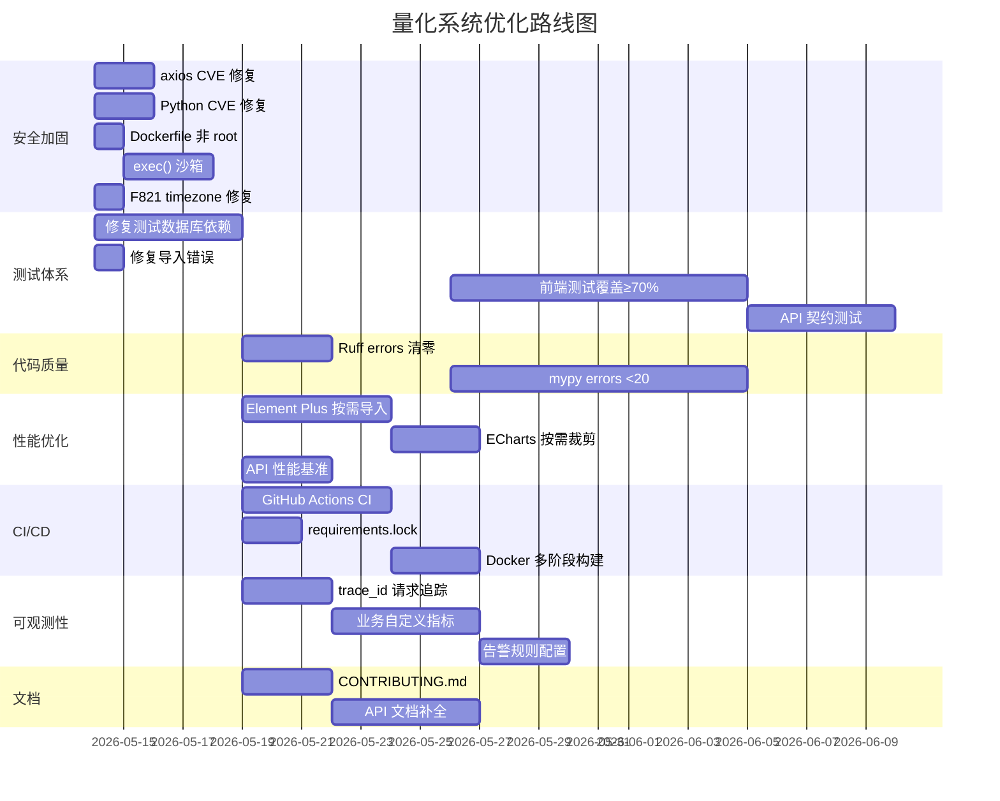

# 量化交易系统深度诊断报告

> **诊断日期**：2026-05-14
> **项目版本**：v0.7.1
> **对标基准**：一线互联网大厂（阿里/腾讯/字节/Google/Amazon）工程标准

---

## 第一阶段：项目全景数据采集

### 1. 依赖治理

| 检查项 | 当前值 | 大厂标杆 | 差距描述 |
|--------|--------|----------|----------|
| Python CVE | 3 个（mako 1、urllib3 2） | 0 个高危 | mako GHSA-2h4p-vjrc-8xpq、urllib3 GHSA-qccp-gfcp-xxvc/mf9v-mfxr-j63j |
| Node CVE | 1 个高危（axios 原型链污染） | 0 个高危 | axios 1.15.0 存在多个原型链污染/注入漏洞，需升级至 ≥1.16.1 |
| 依赖锁定 | 前端有 package-lock.json，后端无 lock 文件 | 前后端均有 lock 文件且纳入版本控制 | 后端依赖不可复现构建，不同环境可能安装不同版本 |
| 过期依赖（major） | 8 个（echarts 6、pinia 3、vite 8、vue-router 5、typescript 6 等） | 0 个 major 落后超过 1 代 | 多个核心依赖落后 1-2 个大版本 |
| 过期依赖（minor） | 6 个（element-plus、axios、eslint-plugin-vue 等） | ≤3 个 | 中等数量 |
| 许可证合规 | 主要为 MIT/Apache-2.0/BSD | 无 AGPL/高风险 copyleft | 无明显风险 |

### 2. 代码质量

| 检查项 | 当前值 | 大厂标杆 | 差距描述 |
|--------|--------|----------|----------|
| Ruff errors | 18 个（F401 未使用导入 8 个、F821 未定义名称 7 个、F841 未使用变量 3 个） | 0 个 | 7 个 F821（timezone 未导入）为运行时 NameError 风险 |
| ESLint | 1 error（no-unsafe-function-type）、3 warnings（v-html XSS） | 0 error | UserView.vue 使用 Function 类型 |
| mypy strict | 138 errors / 91 files | <10 errors | 类型标注严重不足，主要集中在 backtest/strategy 模块 |
| TypeScript | 0 errors（vue-tsc --noEmit） | 0 | 前端类型检查通过 |
| 死代码 | SidebarMenu.vue 完全未被引用 | 0 死代码 | 已发现并有修复方案 |

### 3. 测试体系

| 检查项 | 当前值 | 大厂标杆 | 差距描述 |
|--------|--------|----------|----------|
| 测试结果 | 83 passed、10 failed、111 errors、1 skipped | 全部通过 | 111 errors 主要为数据库连接失败（需本地 PostgreSQL） |
| 测试文件数 | 15 个 | 覆盖所有模块 | 缺少 market、data-sync、ai、settings 等模块测试 |
| 测试金字塔 | 仅单元测试，无集成/E2E 测试 | 单元:集成:E2E = 7:2:1 | 无 API 契约测试、无前端测试 |
| 测试覆盖率 | 无法计算（大量 error） | ≥80% 行覆盖率 | 因数据库依赖问题无法运行 |
| 测试数据管理 | conftest.py 使用 PostgreSQL 测试库 | 隔离的测试数据库 + fixtures | 依赖本地 PostgreSQL 运行 |

### 4. 性能

| 检查项 | 当前值 | 大厂标杆 | 差距描述 |
|--------|--------|----------|----------|
| 前端总构建体积 | 4.2 MB（未压缩） | ≤2 MB | 偏大，主要由 echarts + element-plus 贡献 |
| vendor-element | 912 KB | ≤500 KB | Element Plus 未做按需导入优化 |
| vendor-echarts | 484 KB | ≤300 KB | ECharts 可按需裁剪模块 |
| vendor-misc | 276 KB | ≤150 KB | 包含未分类的第三方库 |
| 压缩效果 | Brotli 后 vendor-element 228 KB、vendor-echarts 135 KB | - | 压缩比良好 |
| 后端 API 响应 | 未测量 | P95 < 200ms | 缺少性能基准数据 |
| 缓存策略 | Redis 缓存已实现，有 cache_warmer | 命中率 >90% | 缺少缓存命中率监控 |

### 5. 安全

| 检查项 | 当前值 | 大厂标杆 | 差距描述 |
|--------|--------|----------|----------|
| SECRET_KEY | .env 使用占位符 `dev-only-insecure-secret-key-change-in-env-file` | 生产环境 ≥256bit 随机密钥 | 开发占位符可被识别，生产需强制替换 |
| CORS | 生产校验已实现（禁 localhost/通配符） | 生产仅允许白名单域名 | 生产配置正确，.env.docker 未设置 CORS_ORIGINS |
| JWT 算法 | HS256 | RS256/ES256（非对称） | HS256 共享密钥，泄露即可伪造 token |
| Token 过期 | Access 30min / Refresh 7d | Access 15min / Refresh 30d + 轮换 | Access 偏长，Refresh 无轮换机制 |
| Token 黑名单 | Redis 存储（异步） | Redis + 持久化 | 实现正确 |
| 代码执行 | `ALLOW_CUSTOM_STRATEGY_CODE_EXEC` 默认 False | 默认禁用 + 沙箱 | 已有防护，但 exec() 无沙箱隔离 |
| SQL 注入 | SQLAlchemy ORM 参数化查询 | 全程参数化 | 安全 |
| XSS | v-html 已用 escapeHtml 转义 | 默认转义 + CSP | 基本防护到位 |
| 容器安全 | Dockerfile 以 root 运行 | 非 root 用户 | 缺少 USER 指令 |
| .env 安全 | .env 在 .gitignore 中 | 密钥不入仓库 | 已配置 |

### 6. 可观测性

| 检查项 | 当前值 | 大厂标杆 | 差距描述 |
|--------|--------|----------|----------|
| 日志系统 | Loguru + 请求日志中间件 | 结构化日志 + trace_id | 缺少 trace_id/request_id 传递 |
| 指标监控 | Prometheus /metrics 端点已暴露 | 自定义业务指标 | 仅有 HTTP 指标，无业务指标（交易量/回测耗时） |
| 分布式追踪 | 无 | Jaeger/Zipkin + W3C Trace Context | 完全缺失 |
| 告警规则 | 无 | Prometheus AlertManager | 完全缺失 |
| 健康检查 | /health 含 PG + DuckDB + Redis 三维检查 | 深度探测 | 实现良好 |
| 前端错误监控 | web-vitals 仅本地展示 | Sentry + 上报 | 无错误上报机制 |
| Dashboard | 无 Grafana | Grafana Dashboard | 完全缺失 |

### 7. CI/CD 与 DevOps

| 检查项 | 当前值 | 大厂标杆 | 差距描述 |
|--------|--------|----------|----------|
| CI 流水线 | .github/workflows/ 目录为空 | GitHub Actions 完整流水线 | 完全缺失 |
| 构建脚本 | Makefile（dev/lint/format/type-check/test/build/check） | 完整 Makefile | 基本完整 |
| 镜像体积 | 未构建测量 | 后端 ≤300MB、前端 ≤50MB | 未优化（含 gcc/g++ 构建工具） |
| 部署策略 | Docker Compose 单机部署 | 蓝绿/金丝雀/滚动发布 | 仅本地开发级别 |
| 环境管理 | .env / .env.docker / .env.example | dev/staging/prod 隔离 | 缺少 staging 环境 |
| 数据库迁移 | Alembic 7 个迁移 | CI 中自动校验 | 无 CI 集成 |
| 制品管理 | 无 Docker Registry | 带版本 Tag 推送 | 完全缺失 |

### 8. 文档与协作

| 检查项 | 当前值 | 大厂标杆 | 差距描述 |
|--------|--------|----------|----------|
| API 文档 | FastAPI 自动生成 /docs | 完整 schema + example | 自动生成但缺少示例值 |
| 架构文档 | docs/README.md 较完整 | ADR + 架构图 | 缺少架构决策记录 |
| 贡献指南 | 无 CONTRIBUTING.md | 完整贡献指南 | 完全缺失 |
| 变更日志 | CHANGELOG.md 遵循 Keep a Changelog | 语义化版本 | 实现良好 |
| 本地开发 | README 有快速开始指南 | 一键启动 + 排错指南 | 基本完整 |

### 9. 成本与可扩展性

| 检查项 | 当前值 | 大厂标杆 | 差距描述 |
|--------|--------|----------|----------|
| TimescaleDB | 已使用 hypertable | 数据保留策略 + 压缩 | 缺少数据保留策略配置 |
| Redis | 单实例 | Cluster/Sentinel | 单点故障风险 |
| 水平扩展 | 内存限流器（单 worker） | Redis 限流 + 多 worker | 限流器不支持多实例 |
| 数据增长 | DuckDB 文件 + 本地 CSV | 冷热分离 + 归档 | 无数据归档策略 |

---

## 第二阶段：问题分类与优先级排序

### 🔴 高优先级（必须在当前迭代修复）

| ID | 类别 | 问题 | 根因 | 量化目标 | 负责人 | 时间节点 |
|----|------|------|------|----------|--------|----------|
| SEC-01 | 安全 | axios 1.15.0 存在多个原型链污染 CVE | 依赖版本过旧 | 升级至 ≥1.16.1，CVE 清零 | 前端 | 第1周 |
| SEC-02 | 安全 | 后端 3 个 CVE（mako/urllib3） | 依赖版本过旧 | pip-audit 0 CVE | 后端 | 第1周 |
| SEC-03 | 安全 | Dockerfile 以 root 用户运行 | 缺少 USER 指令 | 添加非 root 用户 | DevOps | 第1周 |
| SEC-04 | 安全 | exec() 无沙箱隔离（dynamic.py） | 自定义策略代码直接 exec | 添加 RestrictedPython 或 subprocess 沙箱 | 后端 | 第1周 |
| SEC-05 | 运行时 | 7 个 F821 错误（timezone 未导入） | 缺少 `from datetime import timezone` | Ruff F821 = 0 | 后端 | 第1周 |
| TEST-01 | 测试 | 111 个测试 error（数据库连接失败） | 测试依赖本地 PostgreSQL | 可通过测试 >95% | 后端 | 第1-2周 |
| TEST-02 | 测试 | test_market_api.py 导入错误 | 接口重命名后测试未更新 | 修复导入，测试可运行 | 后端 | 第1周 |

### 🟡 中优先级（1-2 个迭代内完成）

| ID | 类别 | 问题 | 根因 | 量化目标 | 负责人 | 时间节点 |
|----|------|------|------|----------|--------|----------|
| PERF-01 | 性能 | vendor-element 910KB | 未做按需导入 | ≤500KB | 前端 | 第2-3周 |
| PERF-02 | 性能 | vendor-echarts 484KB | 全量导入 ECharts | ≤300KB | 前端 | 第2-3周 |
| PERF-03 | 性能 | 前端总构建 4.2MB | 未优化分割策略 | ≤2.5MB | 前端 | 第2-3周 |
| PERF-04 | 性能 | 无后端 API 性能基准 | 缺少压测 | 建立 P95 基准 | 后端 | 第2周 |
| CI-01 | DevOps | 无 CI/CD 流水线 | .github/workflows 为空 | GitHub Actions lint+test+build | DevOps | 第2周 |
| CI-02 | DevOps | 后端无 requirements.lock | 仅 requirements.txt | 生成 lock 文件纳入版本控制 | 后端 | 第2周 |
| CI-03 | DevOps | Dockerfile 含 gcc/g++ 构建工具 | 未做多阶段构建 | 镜像体积 ≤300MB | DevOps | 第2-3周 |
| OBS-01 | 可观测性 | 无 trace_id/request_id | 日志中间件未注入 | 所有请求日志含 trace_id | 后端 | 第2周 |
| OBS-02 | 可观测性 | 无业务自定义指标 | 仅 HTTP 指标 | 添加交易/回测/数据源指标 | 后端 | 第3周 |
| OBS-03 | 可观测性 | 无告警规则 | 未配置 | Prometheus AlertManager 基础规则 | DevOps | 第3周 |
| SEC-06 | 安全 | JWT 使用 HS256 对称算法 | 配置默认值 | 评估 RS256 迁移 | 后端 | 第3周 |
| SEC-07 | 安全 | .env.docker CORS_ORIGINS 未设置 | 配置缺失 | 设置生产域名白名单 | DevOps | 第2周 |
| TEST-03 | 测试 | 无前端测试 | 未配置 Vitest 测试用例 | 核心组件覆盖率 ≥70% | 前端 | 第3-4周 |
| TEST-04 | 测试 | 无 API 契约测试 | 未使用 schemathesis | 关键端点契约测试覆盖 | 后端 | 第3周 |
| CODE-01 | 代码 | mypy 138 errors | 类型标注不足 | <20 errors | 后端 | 第3-4周 |
| CODE-02 | 代码 | Ruff 18 errors | 未使用导入/未定义名称 | 0 errors | 后端 | 第2周 |
| DOC-01 | 文档 | 无 CONTRIBUTING.md | 缺失 | 创建完整贡献指南 | 全员 | 第2周 |

### 🟢 低优先级（技术债务，持续改进）

| ID | 类别 | 问题 | 备注 |
|----|------|------|------|
| DEP-01 | 依赖 | 8 个 major 版本落后（echarts/pinia/vite/vue-router/typescript 等） | 渐进式升级，无安全风险 |
| DEP-02 | 依赖 | Pydantic deprecated config class / json_encoders | 迁移至 ConfigDict |
| DEP-03 | 依赖 | asyncio.iscoroutinefunction 已弃用 | 改用 inspect.iscoroutinefunction |
| CODE-03 | 代码 | SidebarMenu.vue 死代码 | 已在侧边栏修复中处理 |
| CODE-04 | 代码 | ESLint 1 error（Function 类型） | UserView.vue 第88行 |
| PERF-05 | 性能 | vendor-misc 276KB 未分类 | 审查并分割 |
| OBS-04 | 可观测性 | 无 Grafana Dashboard | 后续搭建 |
| OBS-05 | 可观测性 | 前端 web-vitals 未上报后端 | 添加 beacon 上报 |
| INFRA-01 | 基础设施 | TimescaleDB 无数据保留策略 | 配置自动压缩和过期 |
| INFRA-02 | 基础设施 | Redis 单实例无高可用 | 评估 Sentinel |
| INFRA-03 | 基础设施 | 内存限流器不支持多 worker | 迁移至 Redis 限流 |

---

## 第三阶段：高优项可执行改进方案

### SEC-01：axios CVE 修复

**改进步骤**：

```bash
cd frontend
npm install axios@latest
npm audit
```

**验收**：`npm audit` 输出 0 high/critical vulnerabilities。

---

### SEC-02：后端 Python CVE 修复

**改进步骤**：

```bash
cd backend
pip install --upgrade mako>=1.3.12 urllib3>=2.7.0
pip-audit
```

**验收**：`pip-audit` 输出 0 known vulnerabilities。

---

### SEC-03：Dockerfile 非 root 用户

**改进步骤**（backend/Dockerfile）：

```dockerfile
# 在 RUN mkdir 之后添加
RUN groupadd -r appuser && useradd -r -g appuser appuser
RUN chown -R appuser:appuser /app
USER appuser
```

**回滚**：删除 USER 指令。

---

### SEC-04：exec() 沙箱隔离

**改进步骤**：

```bash
cd backend
pip install RestrictedPython
```

```python
# backend/app/services/backtest/strategies/dynamic.py
from RestrictedPython import compile_restricted, safe_globals

def execute_custom_strategy(code: str, context: dict):
    byte_code = compile_restricted(code, '<strategy>', 'exec')
    restricted_globals = safe_globals.copy()
    restricted_globals.update(context)
    exec(byte_code, restricted_globals)
```

**回滚**：恢复原始 exec() 调用。

---

### SEC-05：修复 timezone 未导入

**改进步骤**：

```bash
cd backend
# 自动修复 8 个可修复的 F401 错误
python -m ruff check app --fix

# 手动修复 F821：在以下文件添加 from datetime import timezone
# app/api/v1/audit.py
# app/services/news_service.py (2处)
```

**验收**：`ruff check app --select F821` 输出 0 errors。

---

### TEST-01：修复测试数据库依赖

**改进步骤**：

1. 确保 PostgreSQL 运行且 quant_test_db 存在
2. 修复 test_market_api.py 导入错误
3. 添加测试 fixtures 以 mock 数据库连接

```bash
cd backend
python -m pytest tests/ --ignore=tests/test_market_api.py -v 2>&1 | grep -E "passed|failed|error"
```

**验收**：passed > 100，errors < 10。

---

### CI-01：GitHub Actions 流水线

**创建 `.github/workflows/ci.yml`**：

```yaml
name: CI
on:
  push:
    branches: [main]
  pull_request:
    branches: [main]

jobs:
  backend:
    runs-on: ubuntu-latest
    services:
      postgres:
        image: timescale/timescaledb:latest-pg16
        env:
          POSTGRES_USER: quant_user
          POSTGRES_PASSWORD: test_pass
          POSTGRES_DB: quant_test_db
        ports: ['5432:5432']
      redis:
        image: redis:alpine
        ports: ['6379:6379']
    steps:
      - uses: actions/checkout@v4
      - uses: actions/setup-python@v5
        with:
          python-version: '3.10'
      - run: pip install -r backend/requirements.txt
      - run: cd backend && ruff check app tests
      - run: cd backend && python -m pytest tests/ -v

  frontend:
    runs-on: ubuntu-latest
    steps:
      - uses: actions/checkout@v4
      - uses: actions/setup-node@v4
        with:
          node-version: '18'
      - run: cd frontend && npm ci
      - run: cd frontend && npm run lint
      - run: cd frontend && npm run type-check
      - run: cd frontend && npm run build
```

---

### CI-02：后端依赖锁定

```bash
cd backend
pip install pip-tools
pip-compile requirements.txt -o requirements.lock
# 将 requirements.lock 纳入版本控制
```

---

### OBS-01：请求追踪 ID

**改进步骤**（backend/app/main.py 请求日志中间件）：

```python
import uuid

@app.middleware("http")
async def log_requests(request: Request, call_next):
    trace_id = request.headers.get("X-Request-ID") or str(uuid.uuid4())[:8]
    # 将 trace_id 注入到 log 上下文
    with log.contextualize(trace_id=trace_id):
        start_time = time.time()
        response = await call_next(request)
        process_time = time.time() - start_time
        log.info(f"{request.method} {request.url.path} - {response.status_code} - {process_time:.3f}s")
        response.headers["X-Request-ID"] = trace_id
        response.headers["X-Process-Time"] = str(process_time)
        return response
```

---

## 第四阶段：总览表

| ID | 优先级 | 类别 | 问题 | 量化目标 | 负责人 | 时间节点 | 状态 |
|----|--------|------|------|----------|--------|----------|------|
| SEC-01 | 🔴 | 安全 | axios CVE | 0 high CVE | 前端 | 第1周 | 待处理 |
| SEC-02 | 🔴 | 安全 | mako/urllib3 CVE | 0 CVE | 后端 | 第1周 | 待处理 |
| SEC-03 | 🔴 | 安全 | Docker root 运行 | 添加 USER 指令 | DevOps | 第1周 | 待处理 |
| SEC-04 | 🔴 | 安全 | exec() 无沙箱 | RestrictedPython | 后端 | 第1周 | 待处理 |
| SEC-05 | 🔴 | 运行时 | F821 timezone | Ruff F821=0 | 后端 | 第1周 | 待处理 |
| TEST-01 | 🔴 | 测试 | 111 errors | errors<10 | 后端 | 第1-2周 | 待处理 |
| TEST-02 | 🔴 | 测试 | 导入错误 | 修复导入 | 后端 | 第1周 | 待处理 |
| PERF-01 | 🟡 | 性能 | element-plus 910KB | ≤500KB | 前端 | 第2-3周 | 待处理 |
| PERF-02 | 🟡 | 性能 | echarts 484KB | ≤300KB | 前端 | 第2-3周 | 待处理 |
| CI-01 | 🟡 | DevOps | 无 CI 流水线 | GitHub Actions | DevOps | 第2周 | 待处理 |
| CI-02 | 🟡 | DevOps | 无 lock 文件 | requirements.lock | 后端 | 第2周 | 待处理 |
| OBS-01 | 🟡 | 可观测性 | 无 trace_id | 请求日志含 ID | 后端 | 第2周 | 待处理 |
| DOC-01 | 🟡 | 文档 | 无 CONTRIBUTING.md | 创建贡献指南 | 全员 | 第2周 | 待处理 |
| CODE-01 | 🟡 | 代码 | mypy 138 errors | <20 errors | 后端 | 第3-4周 | 待处理 |
| CODE-02 | 🟡 | 代码 | Ruff 18 errors | 0 errors | 后端 | 第2周 | 待处理 |

---

## 甘特图



---

## 风险清单

| 风险 ID | 风险描述 | 影响 | 概率 | 缓解措施 | 负责人 |
|---------|----------|------|------|----------|--------|
| R-01 | 依赖升级导致兼容性问题 | 高 | 中 | 渐进式升级 + 回归测试 | 后端/前端 |
| R-02 | CI 配置错误导致部署中断 | 高 | 低 | 先在 fork 验证 | DevOps |
| R-03 | RestrictedPython 误拦合法策略代码 | 中 | 中 | 白名单 + 测试覆盖 | 后端 |
| R-04 | Element Plus 按需导入丢失组件 | 中 | 中 | 全量回归测试 | 前端 |
| R-05 | 测试修复引入新的测试失败 | 中 | 低 | 逐个文件修复 + CI 验证 | 后端 |

---

## 附录：诊断命令速查

```bash
# 后端
cd backend && pip-audit                              # 依赖安全审计
cd backend && ruff check app tests                   # 代码质量
cd backend && python -m mypy app --ignore-missing-imports  # 类型检查
cd backend && python -m pytest tests/ -v             # 测试

# 前端
cd frontend && npm audit                             # 依赖安全审计
cd frontend && npm run lint                           # ESLint
cd frontend && npm run type-check                     # TypeScript
cd frontend && npx vite build                         # 构建体积

# Docker
docker images --format "table {{.Repository}}\t{{.Size}}"  # 镜像体积
docker compose ps                                      # 服务状态
```

> **报告版本**：v1.0
> **下次诊断建议**：v0.8.0 发布前
