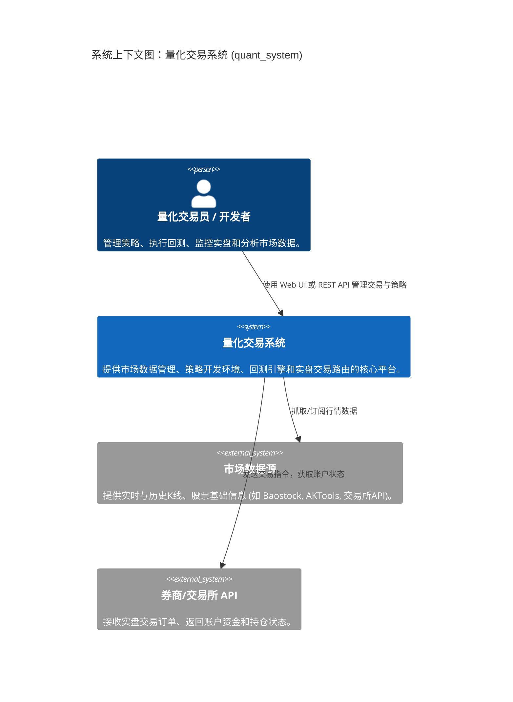
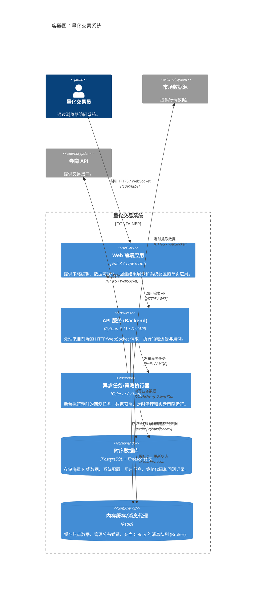
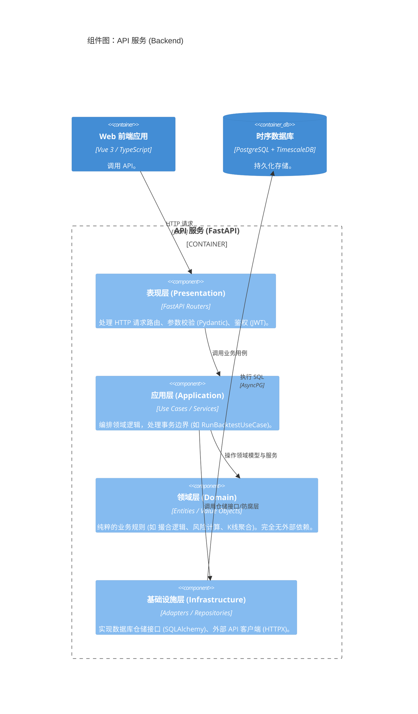

# 量化交易系统 C4 模型架构设计文档

## 1. 系统上下文图 (Context Diagram)

**描述**：系统级视角，展示 `quant_system` 与外部参与者及系统的交互。



## 2. 容器图 (Container Diagram)

**描述**：展开 `quant_system`，展示组成系统的容器（独立运行和部署的单元）。



## 3. 组件图 (Component Diagram)

**描述**：展开 `API 服务 (Backend)` 容器，展示其内部组件结构（基于 DDD 洋葱架构）。



## 4. 代码级设计模式 (Code Diagram - 目录结构)

**描述**：反映 DDD 和整洁架构（Clean Architecture）在代码库中的组织形式。

```text
backend/
├── app/
│   ├── api/                   # 表现层 (Presentation Layer)
│   │   ├── dependencies/      # FastAPI 依赖注入 (鉴权, 数据库会话)
│   │   └── v1/                # 路由 (Controllers)
│   ├── application/           # 应用层 (Application Layer)
│   │   ├── dtos/              # 数据传输对象
│   │   └── use_cases/         # 具体用例 (如 get_stock_klines.py)
│   ├── domain/                # 领域层 (Domain Layer)
│   │   ├── entities/          # 领域实体与聚合根 (纯 Python Dataclasses/Pydantic)
│   │   ├── value_objects/     # 值对象
│   │   ├── repositories/      # 仓储接口 (Interfaces / ABCs)
│   │   └── services/          # 领域服务 (跨实体的核心业务逻辑)
│   ├── infrastructure/        # 基础设施层 (Infrastructure Layer)
│   │   ├── database/          # 数据库连接与 ORM 模型 (SQLAlchemy)
│   │   ├── repositories/      # 仓储接口的具体实现
│   │   └── external/          # 第三方 API 适配器 (防腐层，如 BaostockClient)
│   └── core/                  # 横切关注点 (Cross-cutting Concerns)
│       ├── config.py          # 全局配置
│       ├── security.py        # 鉴权工具
│       ├── exceptions.py      # 统一异常处理
│       └── logger.py          # 日志收集
├── tests/                     # 自动化测试 (单元、集成、E2E)
├── alembic/                   # 数据库迁移脚本
└── pyproject.toml             # 依赖管理 (Poetry)
```